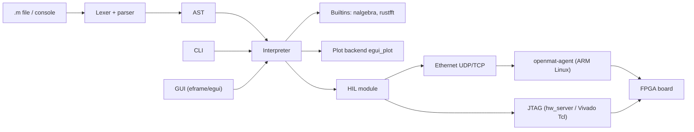

# MATLAB-compatible interpreter in Rust ("openmat")

A free interpreter for MATLAB `.m` files in pure Rust (no Python, no Octave), with a CLI and a native GUI, signal processing, control systems, fixed-point, and an HIL interface to an FPGA. The feature set grows in steps. It is not a complete MATLAB replacement.

## Goal and scope

- Run real `.m` scripts and functions, without Octave and without Python. The parser and interpreter are written entirely in Rust.
- Focus: matrix math, plots, signal processing, control systems, fixed-point, and HIL with an FPGA.
- Not included: Simulink, proprietary toolboxes, and 100% compatibility. The list of supported functions stays a subset.
- Rust has no ready-made SciPy. Filter design (`butter`, `fir1`), control (`tf`, `ss`, `bode`), and similar pieces are written in-house on top of smaller crates.

## Architecture

Cargo workspace with separate crates:

- `openmat-core`: lexer, parser (handwritten Pratt parser), AST, value types, interpreter.
- `openmat-lib`: builtins for linear algebra, DSP, control, and fixed-point.
- `openmat-hil`: transport trait with Ethernet, JTAG, and loopback backends, frame protocol, and board profiles.
- `openmat-agent`: small Rust service for the PYNQ board's ARM Linux (aarch64), access to AXI registers and DMA.
- `openmat-cli`: binary `openmat script.m`, REPL via `rustyline`.
- `openmat-gui`: desktop GUI with `eframe`/`egui` and `egui_plot`.

Chosen crates: `nalgebra` (matrices, `eig`, `svd`, `inv`, `\`), `num-complex`, `rustfft`, `clap`, `rustyline`, `thiserror`.

Data model: `Value` enum with a 2D matrix (real and complex, column-major), string, bool/logical, cell array, struct, and function handle. Everything is at least 2D. Indexes are 1-based.

MATLAB quirks the parser has to handle: transpose `'` versus strings, matrix literals that use spaces as separators (`[1 -2]` versus `[1 - 2]`), `end` in an index, comments `%` and block comments, line continuation `...`, and output suppression with `;`.

## Steps

1. **Core**: parser and interpreter for expressions, variables, matrix literals, indexing, ranges, `if`/`for`/`while`/`switch`, `function` files, anonymous functions, `disp`/`fprintf`. Builtins `zeros`, `ones`, `eye`, `size`, `inv`, `\`, `eig`, `svd`, and more. CLI and REPL. Tests with `cargo test`.
2. **Plots and GUI**: `plot`, `figure`, `hold`, `xlabel`, `title`, `subplot`, `stem`. GUI with editor, console, workspace view, and plot windows.
3. **Signal processing and control**: `fft`/`ifft` (via `rustfft`), `filter`, `conv`, `freqz`, `butter`, `fir1`, `tf`, `ss`, `step`, `bode`, `pole`. Parts of this are implemented in-house.
4. **Fixed-point and FPGA models**: an `fi`-like type with word length, fraction length, rounding, and saturation, bit-accurate. That produces reference models and test-vector files for Vivado testbenches.
5. **HIL with the FPGA (Ethernet and JTAG from the start)**: MATLAB-visible builtins `hil.open`, `hil.write`, `hil.read`, `hil.close`, `hil.regwrite`, `hil.regread`. The transport is swappable through a Rust trait:
   - **Ethernet (UDP/TCP)**: frame protocol with header, length, payload, and CRC. On the PYNQ RFSoC 4x2, a small Rust agent (`openmat-agent`) runs on the ARM Linux. It receives packets and reads or writes AXI registers and DMA buffers in the PL.
   - **JTAG**: connection through the Xilinx `hw_server` (TCP, port 3121), or Vivado in batch mode with Tcl and JTAG-to-AXI.
   - **Loopback mock**: for tests without hardware.
   - VHDL counterparts (AXI register bank, FIFO, packet handling).
   - Board profiles as configuration files (`boards/pynq_rfsoc4x2.toml`, later `boards/explorer.toml`).
6. **Docs**: README with installation, the list of supported functions, and example `.m` scripts.

## Settled assumptions

- Pure Rust, no Python dependency. The GUI is a native desktop app (egui).
- HIL supports Ethernet and JTAG. The first board is the PYNQ RFSoC 4x2. Later, the FPGA Horizons Explorer board.
- The Explorer board arrives in spring 2027. Until then only the profile format exists. Contents follow with the datasheet or constraints.
- The test on a real PYNQ board is run by the user. This repo covers the loopback test, the protocol logic, and the README instructions.
- License: Apache License 2.0. Notice: MATLAB is a trademark of MathWorks. openmat is not affiliated with MathWorks.
